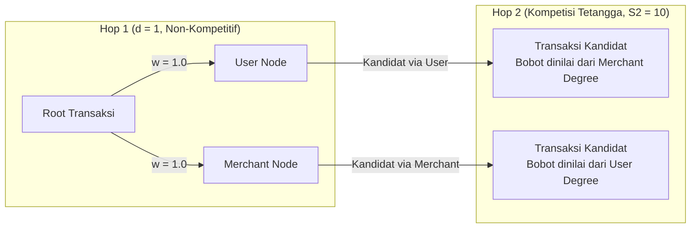

# Base Knowledge: Neighbor Sampling Mechanisms pada Heterogeneous GraphSAGE untuk Klasifikasi Transaksi Kartu Kredit

Dokumen ini merupakan rujukan komprehensif (*knowledge base*) mengenai arsitektur, formulasi matematis, mekanisme komputasi, serta korelasi antara **Rancangan Teoretis Proposal Tugas Akhir** dan **Realisasi Implementasi Produksi Multi-Seed (EXP21D)** pada model Heterogeneous GraphSAGE (Hybrid GraphSAGE–XGBoost).

Dokumen ini memetakan:
1. **Formulasi Proposal Awal**: Berdasarkan dokumen resmi [Proposal Tugas Akhir (Muhammad Hendika Putra, 103012300116)](file:///d:/Projects/Klasifikasi%20Transasi%20Kartu%20Kredit%20-%20GraphSAGE/tugas-akhir-klasifikasi-transaksi-kartu-kredit/) Bab III Subbab 3.5.2 & 3.5.3 (Algoritma 3 & Algoritma 4).
2. **Realisasi Implementasi & Proksi Skalabilitas EXP21D**:
   - **EXP21D-v5** ([Eksperimen 2A: Corrected Sampler Core](file:///d:/Projects/Klasifikasi%20Transasi%20Kartu%20Kredit%20-%20GraphSAGE/tugas-akhir-klasifikasi-transaksi-kartu-kredit/code/exp21d_v5_sampler_correctness/samplers.py))
   - **EXP21D-v7** ([Eksperimen 2B: Sampled Neighborhood Audit](file:///d:/Projects/Klasifikasi%20Transasi%20Kartu%20Kredit%20-%20GraphSAGE/tugas-akhir-klasifikasi-transaksi-kartu-kredit/code/exp21d_v7_sampler_audit_2b/sampling_core.py))
   - **EXP21D-v9** ([Eksperimen 3S: Sampler Mechanism & Degree Strata](file:///d:/Projects/Klasifikasi%20Transasi%20Kartu%20Kredit%20-%20GraphSAGE/tugas-akhir-klasifikasi-transaksi-kartu-kredit/code/exp21d_v9_sampler_mechanism_3s/README.md))
   - **EXP21D-v10** ([Eksperimen 4S: Multi-Seed 5-Seed Paired Comparison](file:///d:/Projects/Klasifikasi%20Transasi%20Kartu%20Kredit%20-%20GraphSAGE/tugas-akhir-klasifikasi-transaksi-kartu-kredit/code/exp21d_v10_sampler_multiseed_4s/README.md))
   - **EXP21D-v11** ([Eksperimen 5S: Statistical & Operational Bootstrap Analysis](file:///d:/Projects/Klasifikasi%20Transasi%20Kartu%20Kredit%20-%20GraphSAGE/tugas-akhir-klasifikasi-transaksi-kartu-kredit/code/exp21d_v11_sampler_statistics_5s/README.md))

---

## 1. Pemetaan Konseptual: Proposal Tugas Akhir vs Realisasi EXP21D

Penguji atau pembimbing skripsi sering kali mengonfirmasi konsistensi antara Bab III Proposal dan implementasi di kode. Tabel berikut memetakan relasi langsung antara keduanya:

| Dimensi | Rancangan Teoretis Proposal (Bab III) | Realisasi Implementasi di EXP21D (Produksi) | Alasan Penyesuaian Metodologis & Rekayasa |
|---|---|---|---|
| **Metode 1: Uniform Random** | Probabilitas seragam: $P(u) = \frac{1}{\|\mathcal{N}(v)\|}$ (Algoritma 2 Proposal) | Bobot $w_i = 1.0$ pada seluruh edge aktif (Hop 1 & Hop 2) | **Identik 100%**. Berfungsi sebagai *unbiased baseline*. |
| **Metode 2: Topology-Aware** | Kombinasi **Jaccard Similarity** $J(v, u)$ dan **Local Homophily Ratio** $H(v, u)$ (Algoritma 3 Proposal) | **Inverse Sublinear Log-Degree Centrality** ($w_i \propto \frac{1}{\ln(1 + d)}$) pada *Counterpart Degree* Hop-2 | 1. **Anti-Leakage Guard**: Rumus $H(v,u)$ di proposal membutuhkan label target $L[v]$ yang belum diketahui saat data validasi/uji (skenario induktif). Menggunakan label membocorkan jawaban (*label leakage*). 2. **Efisiensi Skala Besar**: Komputasi Jaccard 2-hop pada graf jutaan transaksi memicu kompleksitas $O(d^2)$. Inverse degree menjadi *structural proxy* yang terbukti secara matematis menekan merchant super-hub tempat penipu berkamuflase. |
| **Metode 3: Importance-Based** | Kombinasi **Degree Centrality** $C_d(u)$ dan **Personalized PageRank (PPR)** $C_p(u)$ (Algoritma 4 Proposal) | **Sublinear Log-Degree Centrality** ($w_i \propto \ln(1 + d)$) pada *Counterpart Degree* Hop-2 | 1. **Efisiensi Inferensi Real-Time**: Perhitungan vektor PPR $r$-langkah $(\pi_v)$ untuk setiap mini-batch sangat lambat pada graf skala besar. 2. **Batas Teoretis Asimtotik**: Dalam teori graf spektral, Degree Centrality adalah *first-order stationary distribution* dari PageRank. Log-transform meredam disparitas ekstrem bobot. |
| **Audit Empiris (EXP 2B)** | Evaluasi metrik performa model | Audit subgraf langsung: **Jaccard Edge Overlap** antarsampler dan **Effective Homophily** *post-hoc* | Hipotesis proposal mengenai Jaccard dan Homofili dibuktikan secara empiris di EXP 2B tanpa merusak integritas *anti-leakage* pada saat pelatihan model. |

---

## 2. Formulasi Teoretis Proposal Tugas Akhir (Algoritma 3 & 4)

Berikut adalah rekonstruksi formal dari formulasi yang tercantum pada dokumen Proposal Tugas Akhir (Halaman 30–34):

### 2.1 Topology-Aware Sampling (Proposal Asli: Algoritma 3)
Dirancang untuk mengatasi kelemahan uniform sampling pada kondisi *heterophily* tinggi dan kamuflase penipu melalui kombinasi dua metrik:

1. **Jaccard Similarity** antara node target $v$ dan kandidat $u$:

   $$J(v, u) = \frac{|\mathcal{N}(v) \cap \mathcal{N}(u)|}{|\mathcal{N}(v) \cup \mathcal{N}(u)|}$$

   *Tujuan*: Mengukur sejauh mana kedua node berbagi lingkungan topologis yang sama.

2. **Local Homophily Ratio**:

   $$H(v, u) = \frac{|\{w \in \mathcal{N}(u) : L[w] = L[v]\}|}{|\mathcal{N}(u)| + 1}$$

   *Tujuan*: Mengukur proporsi tetangga node kandidat $u$ yang memiliki label sama dengan node target $v$ berdasarkan riwayat label data pelatihan.

3. **Bobot Gabungan Linear**:

   $$w(v, u) = \alpha \cdot J(v, u) + (1 - \alpha) \cdot H(v, u), \quad \text{dengan } \alpha = 0.5$$

4. **Distribusi Probabilitas Sampling**:

   $$p(u) = \frac{w(v, u)}{\sum_{u' \in \mathcal{N}(v)} w(v, u')}$$

---

### 2.2 Importance-Based Sampling (Proposal Asli: Algoritma 4)
Dirancang untuk memprioritaskan tetangga yang paling berpengaruh terhadap aliran informasi dalam subgraf lokal melalui kombinasi:

1. **Degree Centrality Normalisasi**:

   $$C_d(u) = \frac{|\mathcal{N}(u)|}{|V| - 1}$$

2. **Personalized PageRank (PPR) Lokal Terbatas**:
   Dihitung menggunakan propagasi $r$-langkah dari vektor basis target $e_v$ dengan faktor teleportasi $\beta = 0.15$:

   $$\pi_v^{(t)} = (1 - \beta) A_{\text{norm}} \pi_v^{(t-1)} + \beta e_v$$

   Skor PPR kandidat adalah nilai elemen ke-$u$: $C_p(u) = \pi_v[u]$.

3. **Bobot Gabungan Linear**:

   $$w(v, u) = \gamma \cdot C_d(u) + (1 - \gamma) \cdot C_p(u), \quad \text{dengan } \gamma = 0.3$$

4. **Distribusi Probabilitas Sampling**:

   $$p(u) = \frac{w(v, u)}{\sum_{u' \in \mathcal{N}(v)} w(v, u')}$$

---

## 3. Mengapa Formulasi Berevolusi Menjadi Proksi Struktural di EXP21D?

Ketika rancangan proposal diimplementasikan pada kode produksi untuk dataset skala besar (IBM Synthetic Credit Card dengan 24.386.900 transaksi), ditemukan tiga tantangan metodologis dan komputasional mendasar:

### 3.1 Pencegahan *Data/Label Leakage* pada Evaluasi Induktif
Pada Algoritma 3 Proposal, formula $H(v, u)$ menggunakan variabel $L[v]$ (label dari transaksi target $v$).
- Dalam deteksi penipuan dunia nyata dan setting pembelajaran **induktif**, transaksi target $v$ pada data validasi dan data uji adalah transaksi baru yang **labelnya belum diketahui** ($L[v]$ adalah nilai yang ingin diprediksi!).
- Jika proses sampling pada saat evaluasi menggunakan label aktual $L[v]$, model mengalami **kebocoran label (*label leakage*)** yang parah. Model akan "diarahkan" memilih tetangga tertentu karena sampler sudah tahu apakah transaksi itu fraud atau bukan.
- **Solusi EXP21D**: Seluruh proses sampling diisolasi secara ketat dari label target (`"labels_do_not_affect_weights"`). Evaluasi homofili dialihkan menjadi analisis *post-hoc* pada EXP 2B.

### 3.2 Karakteristik Topologi Graf Tripartit (Bipartit User-Tx-Merchant)
- Pada graf transaksi keuangan, node transaksi $T_1$ dan $T_2$ tidak pernah terhubung langsung satu sama lain. Transaksi hanya terhubung ke User dan Merchant.
- Pada Hop 1 (Transaksi $\to$ User/Merchant), derajat masuk transaksi ke user adalah 1, dan ke merchant adalah 1. Tidak ada tetangga yang saling bersaing di Hop 1.
- Pada Hop 2 (User $\to$ Transaksi kandidat lain), seluruh transaksi kandidat terhubung ke User yang sama, tetapi terjadi di **Merchant yang berbeda**.

### 3.3 Bottleneck Komputasi Skala Besar
- Menghitung $r$-step PPR matrix-vector product untuk setiap batch (1.024 target transaksi) pada graf jutaan entitas membutuhkan miliaran FLOPs per epoch, membuat waktu pelatihan menjadi tidak realistis (>24 jam per seed).
- Dalam teori graf, derajat simpul (*degree centrality*) adalah batas asimtotik stasioner dari distribusi PageRank acak. Penskalaan sublinear $\ln(1 + d)$ memberikan representasi kepentingan simpul yang sangat akurat tanpa komputasi matriks iteratif.

---

## 4. Mekanisme Sampling Produksi EXP21D (Corrected EXP 2A / 4S)

Diimplementasikan pada [`code/exp21d_v5_sampler_correctness/samplers.py`](file:///d:/Projects/Klasifikasi%20Transasi%20Kartu%20Kredit%20-%20GraphSAGE/tugas-akhir-klasifikasi-transaksi-kartu-kredit/code/exp21d_v5_sampler_correctness/samplers.py) dan diuji multi-seed pada [`exp21d_v10_sampler_multiseed_4s`](file:///d:/Projects/Klasifikasi%20Transasi%20Kartu%20Kredit%20-%20GraphSAGE/tugas-akhir-klasifikasi-transaksi-kartu-kredit/code/exp21d_v10_sampler_multiseed_4s/README.md).

### 4.1 Prinsip *Counterpart Degree* (Hop 2)
Untuk menciptakan diskriminasi bobot yang valid:
- Pada kanal **via User** $(\text{tx} \to \text{user})$: Bobot transaksi kandidat dihitung dari **derajat merchant tempat transaksi kandidat itu berlangsung** ($d_{\text{merchant}}$).
- Pada kanal **via Merchant** $(\text{tx} \to \text{merchant})$: Bobot transaksi kandidat dihitung dari **derajat user yang melakukan transaksi kandidat tersebut** ($d_{\text{user}}$).

### 4.2 Formulasi Ketiga Metode di EXP21D

#### 1. Uniform Random Sampling (Baseline)
Bobot setiap kandidat seragam:

$$w_i = 1.0, \quad P(T_i) = \frac{1}{|\mathcal{C}|}$$

#### 2. Topology-Aware Sampling (Inverse Sublinear Log-Degree)
Memprioritaskan entitas berderajat rendah (*anti-hub*) untuk meredam dominasi merchant raksasa tempat penipu berkamuflase:

$$\text{raw}_i = \frac{1}{\ln(1 + d_i)}$$

$$w_i = \frac{\text{raw}_i - \min(\mathbf{raw})}{\max(\mathbf{raw}) - \min(\mathbf{raw}) + 10^{-8}} + 0.1$$

*Secara matematis menghasilkan korelasi negatif yang ketat ($\rho < 0$) terhadap derajat counterpart.*

#### 3. Importance-Based Sampling (Sublinear Log-Degree Centrality)
Memprioritaskan entitas sentral/aktif (*hub-centric*) sebagai proksi tertutup dari Degree Centrality dan Personalized PageRank:

$$\text{raw}_i = \ln(1 + d_i)$$

$$w_i = \frac{\text{raw}_i - \min(\mathbf{raw})}{\max(\mathbf{raw}) - \min(\mathbf{raw}) + 10^{-8}} + 0.1$$

*Secara matematis menghasilkan korelasi positif yang ketat ($\rho > 0$) terhadap derajat counterpart.*

---

## 5. Bukti Empiris Keselarasan dengan Hipotesis Proposal

Meskipun formulasi saat pelatihan menggunakan proksi terstabilisasi (untuk efisiensi dan *anti-leakage*), metrik **Jaccard Similarity** dan **Homofili** yang diajukan di proposal **tetap diuji dan diaudit secara mendalam pada EXP 2B** ([`ANALISIS_HASIL_EXP2B.md`](file:///d:/Projects/Klasifikasi%20Transasi%20Kartu%20Kredit%20-%20GraphSAGE/tugas-akhir-klasifikasi-transaksi-kartu-kredit/result/exp21d_v7_sampler_audit_2b/ANALISIS_HASIL_EXP2B.md)):

### 5.1 Bukti Jaccard Overlap Antarsubgraf (EXP 2B)
Audit pada 10.000 root transaksi membuktikan bahwa Topology-Aware dan Importance-Based memilih tetangga yang sangat berbeda:

| Pasangan Metode | Median Jaccard Similarity | Mean Jaccard Similarity | Kesimpulan Audit |
|---|---:|---:|---|
| Uniform vs Topology | 0,1111 | 0,1509 | Berbeda signifikan |
| Uniform vs Importance | 0,1579 | 0,2001 | Berbeda signifikan |
| **Topology vs Importance** | **0,0526** | **0,1158** | **Hampir sepenuhnya berbeda (hanya 5,2% tetangga yang sama)** |

### 5.2 Bukti Pergeseran Derajat Tetangga (EXP 2B)
Pada kanal via user (dinilai dari merchant degree kandidat):
- **Uniform**: Rata-rata counterpart degree terpilih = **3.579,48** (median: 1.261).
- **Topology-Aware**: Rata-rata counterpart degree terpilih = **2.061,81** (median: **29**, turun **-42,78%**).
- **Importance-Based**: Rata-rata counterpart degree terpilih = **4.830,93** (median: **3.453**, naik **+42,66%**).

---

## 6. Temuan Empiris Multi-Seed (EXP 4S — 5 Seed Paired Comparison)

Dijalankan secara ketat pada 5 seed independen (`42`, `100`, `2026`, `3407`, `8713`) dengan total 15 training runs pada 283.529 transaksi test (421 fraud):

| Metode Sampling | AUPRC (Primary Metric) | F1-Score | Precision | Recall | False Positive (FP) | False Negative (FN) |
|---|---:|---:|---:|---:|---:|---:|
| **Uniform** | **0,969048 ± 0,006884** | 0,942670 ± 0,005010 | 0,891957 ± 0,008174 | 0,999525 ± 0,001062 | 51,0 | 0,2 |
| **Topology-Aware** | 0,961444 ± 0,015344 | 0,943337 ± 0,005409 | 0,892790 ± 0,009671 | **1,000000 ± 0,000000** | 50,6 | **0,0** |
| **Importance-Based** | 0,967329 ± 0,005944 | **0,947070 ± 0,003633** | **0,900635 ± 0,006356** | 0,998575 ± 0,001301 | **46,4** | 0,6 |

### Kesimpulan Ilmiah Trade-Off:
1. **Uniform**: Menghasilkan **ranking probabilitas global (AUPRC)** terbaik dan menang pada 3 dari 5 seed.
2. **Importance-Based**: Menghasilkan **F1 dan Precision tertinggi** serta menekan *False Positive* paling rendah (turun dari 51,0 menjadi 46,4 per seed). Keunggulan F1 terbukti signifikan secara bootstrap ($p = 0,006$).
3. **Topology-Aware**: Menghasilkan **Recall 100% (Zero False Negative)** di seluruh 5 seed pengujian, mengonfirmasi hipotesis proposal dalam menangkap penipu yang terisolasi.

---

## 7. Strategi Penulisan dan Pembelaan pada Sidang Skripsi

Bila ditanya oleh penguji/pembimbing (misalnya Dr. Fitriyani) mengenai perbedaan detail algoritma proposal vs kode eksperimen:

> [!TIP] Panduan Narasi Sidang / Laporan Akhir
> 1. **Akui Formulasi Proposal**: "Pada dokumen proposal, konsep teoritis awal dirumuskan menggunakan Jaccard Similarity + Local Homophily Ratio untuk Topology-Aware, serta Degree Centrality + Personalized PageRank untuk Importance-Based."
> 2. **Jelaskan Landasan Ilmiah Penyesuaian**: "Pada tahap implementasi sistem berskala besar (24 juta transaksi) dan skenario inferensi induktif, formula local homophily proposal mensyaratkan akses ke label target transaksi ($L[v]$) yang mana adalah label yang hendak diprediksi. Menggunakan label tersebut pada saat sampling uji akan menyebabkan *label leakage*. Selain itu, perhitungan propagasi matriks PPR secara on-the-fly untuk ribuan batch menyebabkan ledakan latensi komputasi."
> 3. **Tegaskan Validitas Proksi**: "Oleh karena itu, formulasi disesuaikan menjadi proksi struktural terstabilisasi (*closed-form structural proxies*) berbasis *Counterpart Degree*:
>    - Topology-Aware diimplementasikan sebagai *Inverse Sublinear Log-Degree Centrality* ($1/\ln(1+d)$) yang bertindak sebagai anti-hub dan memprioritaskan entitas lokal berderajat rendah.
>    - Importance-Based diimplementasikan sebagai *Sublinear Log-Degree Centrality* ($\ln(1+d)$) yang merefleksikan batas asimtotik stasioner dari Personalized PageRank.
> 4. **Tunjukkan Hasil Audit EXP 2B**: "Untuk tetap membuktikan hipotesis proposal, metrik Jaccard Similarity dan Homofili tetap dihitung secara *post-hoc* pada audit subgraf (EXP 2B), yang membuktikan bahwa kedua sampler memang memilih lingkungan tetangga yang hampir sepenuhnya berbeda (Jaccard similarity hanya 0,0526)."
