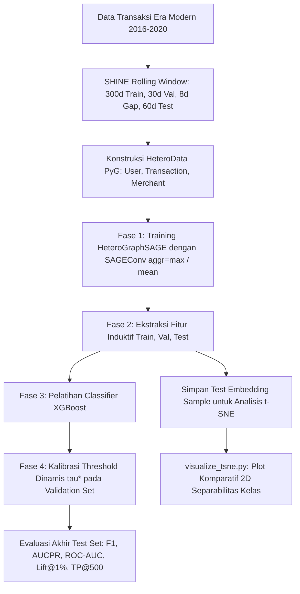

# Penjelasan Mendalam Pipeline Eksperimen 22 (EXP22)
## *Inovasi Agregator Pesan GNN: Elementwise Maximization vs Mean Pooling*

---

## 1. Latar Belakang & Masalah: *Minority Feature Dilution*

Dalam deteksi penipuan kartu kredit berbasis graf (*Graph-based Fraud Detection*), perbandingan transaksi normal terhadap transaksi fraud sangat timpang (mencapai rasio ~1 : 700 atau fraud rate $\approx 0.15\%$).

Pada arsitektur Graph Neural Network konvensional (seperti GraphSAGE standar), fungsi agregasi ketetanggaan yang umum digunakan adalah **`mean`**:

$$m_{\mathcal{N}_i} = \frac{1}{|\mathcal{N}_i|} \sum_{j \in \mathcal{N}_i} h_j$$

### Mengapa Agregator `mean` Mengalami Kegagalan pada Graf Bipartit Transaksi?
Pada graf transaksi, sebuah entitas (misalnya Merchant ternama atau User aktif) dapat memiliki puluhan hingga ribuan transaksi normal yang terhubung. Apabila terjadi 1 atau 2 transaksi fraud:
1. Vektor representasi transaksi fraud $h_{\text{fraud}}$ yang membawa sinyal anomali tajam akan dijumlahkan dengan ratusan hingga ribuan vektor transaksi normal $h_{\text{normal}}$.
2. Hasil penjumlahan tersebut kemudian dibagi dengan total derajat $|\mathcal{N}_i|$.
3. **Efek Pengenceran (*Feature Dilution*)**: Sinyal anomali minoritas teredam secara masif (*diluted to near-zero*) ke dalam nilai rata-rata ketetanggaan mayoritas. Akibatnya, representasi embedding dari entitas dan transaksi fraud kehilangan daya bedanya (*separability*).

---

## 2. Landasan Matematis SHINE: *Elementwise Maximization*

Untuk mengatasi kelemahan fundamental di atas, paper **SHINE (IEEE TKDE 2024, Bagian III-D1, Persamaan 10 & 11)** mengusulkan penggantian agregator linear (*mean*) dengan fungsi non-linear berbasis **`elementwise maximization`**:

$$m_k = \max_{1 \le j \le |\mathcal{N}_{i,r}|} (H_{jk})$$

di mana:
* $|\mathcal{N}_{i,r}|$ adalah himpunan tetangga dari node $i$ pada relasi $r$.
* $H_{jk}$ adalah nilai aktivasi fitur pada dimensi tersembunyi ke-$k$ dari tetangga ke-$j$.

### Keunggulan Matematis Agregator `max`:
1. **Preservasi Aktivasi Ekstrem (*Extreme Value Preservation*)**: Karena operasi $\max$ memilih nilai aktivasi tertinggi pada tiap kanal dimensi secara independen, sinyal anomali ekstrem yang dipancarkan oleh tetangga fraud tidak akan terpengaruh oleh berapapun banyaknya tetangga normal yang ada.
2. **Robust terhadap *Degree Imbalance***: Nilai pesan tidak tereduksi oleh besarnya derajat node penyerap pesan, sehingga merchant bervolume tinggi tetap mampu memancarkan sinyal bahaya jika terdapat transaksi fraud.

---

## 3. Desain Ablasi Terkontrol (*Controlled Ablation Study*)

Pada EXP22, kami mengisolasi variabel agregator secara murni dengan menjaga seluruh komponen lain tetap identik:

| Parameter Eksperimen | Varian Baseline (A) | Varian Proposed (B) | Varian Opsi (C) |
| :--- | :---: | :---: | :---: |
| **Fungsi Agregasi SAGEConv** | `aggr='mean'` | `aggr='max'` | `aggr='sum'` |
| **Arsitektur GNN** | 2-Layer HeteroGraphSAGE | 2-Layer HeteroGraphSAGE | 2-Layer HeteroGraphSAGE |
| **Dimensi Tersembunyi** | 128 | 128 | 128 |
| **Kanal Input** | Linear Projection (15d tx, 2d user, 2d merchant) | Linear Projection (15d tx, 2d user, 2d merchant) | Linear Projection (15d tx, 2d user, 2d merchant) |
| **Aktivasi & Normalisasi** | ReLU + BatchNorm1d | ReLU + BatchNorm1d | ReLU + BatchNorm1d |
| **Sampling Strategi** | Uniform Random Sampling | Uniform Random Sampling | Uniform Random Sampling |
| **Protokol Waktu** | SHINE FRAUD II (300d / 30d / 8d / 60d) | SHINE FRAUD II (300d / 30d / 8d / 60d) | SHINE FRAUD II (300d / 30d / 8d / 60d) |
| **Classifier** | XGBoost (n_estimators=100, depth=5) | XGBoost (n_estimators=100, depth=5) | XGBoost (n_estimators=100, depth=5) |
| **Random Seed** | 42 | 42 | 42 |

---

## 4. Alur 4 Fase Pipeline Eksekusi

### Fase 1: Pelatihan GraphSAGE Encoder
* Encoder dilatih selama 10 epoch dengan `Class-Weighted Binary Cross-Entropy Loss` untuk mengompensasi ketimpangan kelas.
* Bobot `pos_weight = num_negatives / num_positives`.

### Fase 2: Ekstraksi Fitur Representasi Induktif
* Menggabungkan fitur orisinal tabular (15 dimensi) dengan representasi embedding laten GNN (128 dimensi).
* Ekstraksi dilakukan secara strictly inductive:
  * Fitur Train: Graf Train.
  * Fitur Validation: Graf Train + Validation (tanpa Test, mencegah data leakage).
  * Fitur Test: Graf Train + Validation + Test.
* Menyimpan subsampel representasi test (seluruh transaksi fraud + 5.000 transaksi normal acak) ke dalam format `.npz` terkompresi.

### Fase 3: Pelatihan Model Prediksi XGBoost
* Melatih classifier pohon XGBoost pada fitur gabungan (143 dimensi).
* Menggunakan `tree_method='hist'` dengan akselerasi GPU (fallback otomatis ke CPU multithreaded jika CUDA tidak tersedia).

### Fase 4: Kalibrasi Threshold Dinamis & Evaluasi Akhir
* Melakukan sweep threshold $\tau \in [0.01, 0.50]$ pada Validation Set untuk menemukan $\tau^*$ yang memaksimalkan F1-Score.
* Mengaplikasikan $\tau^*$ pada Test Set untuk memulihkan Recall tanpa mengorbankan Precision secara berlebihan.
* Menghitung metrik bebas threshold: **AUCPR (AUPRC)** dan **ROC-AUC**.
* Menghitung metrik operasional perbankan: **Lift@1%** dan **TP@500**.

---

## 5. Metodologi Analisis t-SNE (*t-Distributed Stochastic Neighbor Embedding*)

Skrip `visualize_tsne.py` memetakan representasi vektor laten 128 dimensi ke ruang 2 dimensi untuk mengonfirmasi hipotesis secara visual:
* **Pada Varian `mean`**: Titik-titik fraud diproyeksikan bertumpuk di dalam klaster transaksi normal akibat pelemahan sinyal (*dilution*).
* **Pada Varian `max`**: Titik-titik fraud membentuk klaster atau kelompok anomali terpisah di tepi ruang representasi (*anomaly preservation*), sehingga lebih mudah dipisahkan oleh *decision boundaries* dari XGBoost.
