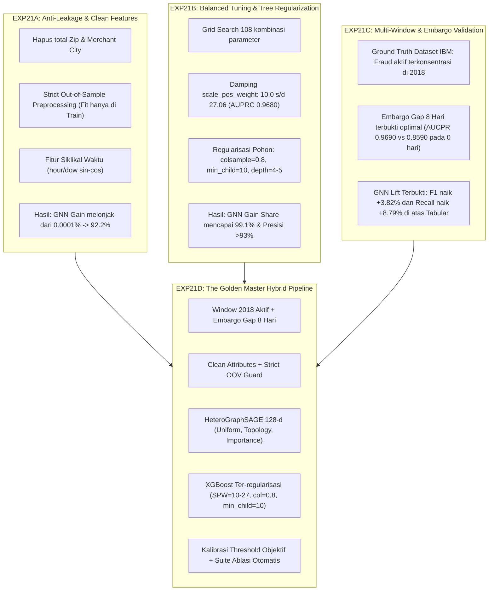

# Rencana Eksperimen 21D (EXP21D): The Golden Master Hybrid Pipeline
## *Sintesis Komprehensif: Strict Anti-Leakage, Optimal Regularization, dan Validated Temporal Window*

---

## 1. Identitas Eksperimen & Ringkasan Eksekutif

* **ID Eksperimen**: `EXP21D`
* **Nama Rencana**: *The Golden Master Hybrid Pipeline (Synthesis of EXP21A, EXP21B, and EXP21C)*
* **Tipe Eksperimen**: Model Final Sintesis & Master Benchmark (Refinement Utama EXP21)
* **Dokumen Rujukan**:
  - [`planning/07_eksplorasi_data_splitting_atribut_tuning_exp21.md`](07_eksplorasi_data_splitting_atribut_tuning_exp21.md) (Dokumen Arahan Pembimbing)
  - [`result/exp21a/README.md`](../result/exp21a/README.md) (Hasil Remediasi Kebocoran Atribut)
  - [`result/exp21b/README.md`](../result/exp21b/README.md) (Hasil Tuning Hiperparameter & Regularisasi Pohon)
  - [`result/exp21c/README.md`](../result/exp21c/README.md) (Hasil Multi-Window Temporal Splitting & Embargo Gap)
* **Target Utama**: 
  Membangun satu konfigurasi model hibrida GraphSAGE + XGBoost terbaik (**The Golden Master**) yang mengintegrasikan seluruh temuan dan opsi optimal yang telah divalidasi secara empiris dari EXP21A, EXP21B, dan EXP21C, serta menyajikan matriks ablasi lengkap untuk menjadi **tabel hasil utama Bab 4 Tugas Akhir**.

---

## 2. Landasan Empiris: Sintesis Hasil EXP21A, EXP21B, dan EXP21C

Perancangan EXP21D didasarkan pada fakta-fakta ilmiah yang telah dibuktikan pada tiga eksperimen terdahulu:

### Rangkuman Temuan Inti yang Diintegrasikan:
1. **Eliminasi Total Hafalan Atribut (dari EXP21A)**:
   - Kolom kardinalitas tinggi `Zip` (~25.000 kategori) dan `Merchant City` (~10.000 kategori) **wajib dihapus total**.
   - `StandardScaler` dan `LabelEncoder` **hanya boleh di-`fit` pada data Train**. Nilai kategori baru pada Val/Test di-mapping ke `<OOV>`.
   - Dampak: XGBoost tidak lagi menghafal kode pos, sehingga kontribusi split gain pohon beralih penuh ke representasi graf (**GNN Gain Share $>90\%$**).
2. **Konfigurasi Hiperparameter XGBoost Juara (dari EXP21B)**:
   - Pembobotan kelas `scale_pos_weight` ekstrem (732.18) merusak presisi dan menurunkan AUCPR. Bobot teredam `scale_pos_weight = 10.0` atau `27.06` ($\sqrt{\text{neg}/\text{pos}}$) menghasilkan **AUCPR tertinggi (0.9680)** dan presisi tertinggi (**93.35%**).
   - Parameter pohon ter-regularisasi (`max_depth = 4`, `min_child_weight = 10`, `colsample_bytree = 0.8`, `subsample = 0.8`) mencegah overfitting pada sampel tunggal dan memaksa pohon memanfaatkan 128 fitur embedding GNN secara merata.
3. **Horizon Waktu & Embargo Gap Terverifikasi (dari EXP21C)**:
   - Audit data multi-window membuktikan bahwa dataset transaksi kartu kredit IBM hanya menyuntikkan fraud secara aktif pada **Window 2018–2019** (Train 2018: 1.930 fraud; Val: 291 fraud; Gap: 81 fraud; Test: 421 fraud).
   - Durasi **Embargo Gap 8 hari** (standar paper SHINE) terbukti memberikan trade-off paling ideal antara masa pelaporan fraud dan *concept drift* (F1 0.9433 vs 0.9034 pada gap 0 hari).
   - Model Hybrid terbukti memberikan **+8.79% absolute lift pada Recall** (dari 90.97% Tabular ke 99.76% Hybrid) dan **+3.82% absolute lift pada F1-Score**.

---

## 3. Spesifikasi Teknis & Desain Arsitektur EXP21D

### 3.1. Penyelarasan Partisi Temporal (Temporal Partitioning Setup)
Mengadopsi protokol baku *SHINE FRAUD II* pada horizon aktif 2018:
* **Reference Date ($T_0$)**: `2018-01-01 00:00:00`
* **Training Window**: 300 hari (01 Jan 2018 s/d 28 Okt 2018) — $\approx 1.415.044$ transaksi, $1.930$ fraud (0.136%).
* **Validation Window**: 30 hari (28 Okt 2018 s/d 27 Nov 2018) — $\approx 141.270$ transaksi, $291$ fraud (0.206%). Digunakan khusus untuk early stopping GNN dan kalibrasi threshold $\tau^*$.
* **Embargo Gap Window**: 8 hari (27 Nov 2018 s/d 05 Des 2018) — $\approx 37.515$ transaksi, $81$ fraud (0.216%). Menyimulasikan jeda investigasi chargeback bank.
* **Test Window**: 60 hari (05 Des 2018 s/d 03 Feb 2019) — $\approx 283.529$ transaksi, $421$ fraud (0.149%). Horizon evaluasi akhir out-of-sample masa depan.

### 3.2. Rekayasa Atribut Tabular Bersih (Clean Feature Engineering)
* **Atribut Dihapus (Excluded)**: `Zip`, `Merchant City` (menjamin nol kebocoran identitas).
* **Atribut Transaksi Inti (9 Fitur Clean Tabular)**:
  1. `Amount`: Nominal transaksi (dinormalisasi via `StandardScaler` yang di-fit strictly di Train).
  2. `Use Chip`: Metode transaksi (Swipe, Chip, Online) via One-Hot / Label encoding.
  3. `Merchant State`: Wilayah negara bagian merchant (kardinalitas rendah ~50 kategori) dengan handling `<OOV>`.
  4. `MCC`: *Merchant Category Code* (kardinalitas menengah ~100 kategori) dengan handling `<OOV>`.
  5. `Errors?`: Indikator error teknis transaksi (PIN salah, saldo tidak cukup, dll).
  6. `hour_sin`: $\sin(2\pi \cdot \text{jam} / 24)$ — siklus diurnal transaksi.
  7. `hour_cos`: $\cos(2\pi \cdot \text{jam} / 24)$.
  8. `dow_sin`: $\sin(2\pi \cdot \text{hari} / 7)$ — siklus mingguan (weekend vs weekday).
  9. `dow_cos`: $\cos(2\pi \cdot \text{hari} / 7)$.
* **Atribut Tambahan Rekayasa Perilaku (*Behavioral Anomaly*, ATTR-3)**:
  10. `amount_log`: $\ln(1 + \text{Amount})$ untuk meredam skewness ekstrem nominal.
  11. `is_high_risk_mcc`: Flag biner untuk MCC kategori berisiko tinggi (misal: perhiasan, elektronik, kasino).

### 3.3. Arsitektur Representasi Graf (HeteroGraphSAGE)
* **Topologi Graf**: Tripartit Heterogen:
  - Tipe Node: `User`, `Merchant`, `Transaction`
  - Tipe Edge: `(User, makes, Transaction)`, `(Transaction, at, Merchant)`, dan relasi balik (*reverse edges*).
* **Konfigurasi Layer**:
  - `num_layers`: **2 Layer** `HeteroConv(SAGEConv)`
  - `hidden_channels`: **128 dimensi**
  - `aggr`: `'mean'` (baseline teruji) dengan modul ablasi perbandingan `'max'` (mengacu EXP22).
  - `dropout`: **0.20**
  - `weight_decay`: **0.0001**
  - `learning_rate`: **0.001** dengan `ReduceLROnPlateau(factor=0.5, patience=3)`
  - `batch_size`: **1024**
  - `max_epochs`: **20 Epoch** dengan `early_stopping_patience = 7` pada validation AUPRC.
  - `loss_weight_strategy`: `'sqrt'` ($\text{pos\_weight} \approx 27.0$), `label_smoothing = 0.0`.
* **Neighbor Sampling Strategies (3 Pilar Inti TA)**:
  - **Hop-1 Fanout**: 15 tetangga; **Hop-2 Fanout**: 10 tetangga.
  - Tiga metode sampling dieksekusi secara sejajar:
    1. **Uniform Sampling**: Pengambilan sampel acak berdistribusi seragam.
    2. **Topology-Aware Sampling**: Pembobotan sublinear log-degree $w_e = \log(1 + \deg(src))$.
    3. **Importance-Based Sampling**: Pembobotan gabungan topologi dan temporal recency.

### 3.4. Pengklasifikasi Hilir (Regularized XGBoost Classifier)
Konfigurasi optimal hasil validasi EXP21B:
* `n_estimators`: 100
* `max_depth`: 4 (pohon dangkal untuk mencegah *overfitting*)
* `learning_rate`: 0.05
* `min_child_weight`: 10 (mencegah isolasi transaksi tunggal)
* `subsample`: 0.8
* `colsample_bytree`: 0.8 (memaksa ensemble memanfaatkan kombinasi fitur graf dan tabular)
* `scale_pos_weight`: **27.06** (damped sqrt) atau **10.0**

### 3.5. Protokol Binerisasi & Kalibrasi Threshold Terarah (TUNE-4)
* Kalibrasi threshold dilakukan secara terisolasi pada **Validation Window**.
* Fungsi optimasi: Memaksimalkan $F_1(\tau)$ dengan konstrain $\text{Precision}(\tau) \ge 20\%$.
* Melaporkan metrik lengkap pada **Threshold Optimal ($\tau^*$)** dan **Threshold Default ($\tau = 0.50$)**.

---

## 4. Matriks Studi Ablasi & Evaluasi Komparatif EXP21D

EXP21D merangkum 3 dimensi studi komparatif otomatis dalam satu pipeline eksekusi:

### 4.1. Dimensi I: Komparasi 3 Metode Neighbor Sampling
Membandingkan kualitas representasi graf dan hasil deteksi fraud akhir:
1. `Uniform Sampling` (Baseline)
2. `Topology-Aware Sampling`
3. `Importance-Based Sampling`

### 4.2. Dimensi II: Komparasi 3 Subset Fitur (Membuktikan GNN Lift)
Untuk setiap metode sampling, classifier dievaluasi pada 3 subset input:
1. **Tabular Only**: Hanya 9-11 fitur transaksi tanpa graf.
2. **GraphSAGE Only**: Hanya 128 dimensi embedding graf murni.
3. **Hybrid (Proposed Golden Master)**: Gabungan 128 dimensi GNN + 9-11 fitur tabular.

### 4.3. Dimensi III: Audit Kontribusi Split Gain & Integritas Keputusan
* Menghitung total dan persentase gain keputusan pohon:
  $$\% \text{Gain}_{\text{GNN}} = \frac{\sum_{i \in \text{GNN}} \text{Gain}_i}{\sum_{j \in \text{All}} \text{Gain}_j} \times 100\%$$
* Memverifikasi secara kuantitatif bahwa $\% \text{Gain}_{\text{GNN}} \ge 85\%$ (membuktikan bahwa model mengandalkan topologi relasi graf, bukan menghafal atribut).

---

## 5. Struktur Berkas Kode & Rencana Eksekusi

### 5.1. Lokasi Direktori
* Direktori Kode: `code/exp21d/`
* Direktori Output Hasil: `result/exp21d/`
* Direktori Model Checkpoint: `model/exp21d/`

### 5.2. Rencana Berkas Skrip `code/exp21d/`
1. `config.reference.yaml`: Konfigurasi acuan lokal.
2. `config.kaggle.yaml`: Konfigurasi otomatis untuk eksekusi Kaggle GPU.
3. `config.py`: Parser konfigurasi YAML dengan validasi tipe data.
4. `data_preprocessing.py`: Modul pembersihan data, eliminasi ZIP/City, pembagian 4 partisi temporal, dan *strict train-only fit* scaler/encoder.
5. `graph_builder.py`: Modul pembangunan graf heterogen PyG (`User`, `Merchant`, `Transaction`).
6. `samplers.py`: Implementasi 3 neighbor sampler (Uniform, Topology-Aware, Importance-Based).
7. `model.py`: Arsitektur 2-Layer `HeteroGraphSAGE` ter-regularisasi.
8. `main.py`: Pipeline utama yang mengeksekusi pelatihan GNN, inferensi embedding, tuning/training XGBoost, kalibrasi threshold, dan evaluasi test set.
9. `run_all.py`: Orchestrator sekuensial yang menjalankan ketiga metode sampling, studi ablasi subset fitur, dan visualisasi grafik ilmiah.
10. `visualize_results.py`: Generator plot ilmiah 300 DPI (PR/ROC curves, feature gain distribution, GNN lift bar chart, confusion matrix).
11. `create_nb.py` & `create_colab_nb.py`: Generator notebook *self-contained* untuk eksekusi langsung di Kaggle GPU atau Google Colab.
12. `dataset-metadata.json` & `kernel-metadata.json`: Metadata Kaggle API untuk push dataset kode dan run kernel.

---

## 6. Output yang Dihasilkan pada `result/exp21d/`

Setelah eksekusi selesai, folder `result/exp21d/` akan berisi berkas artefak lengkap:
* `exp21d_{sampling}_results.json`: Metrik evaluasi lengkap, ambang batas $\tau^*$, split gain, dan runtime.
* `exp21d_master_comparison.csv`: Tabel komparasi utama antar metode sampling dan subset fitur (siap disalin langsung ke Bab 4 Skripsi).
* `exp21d_{sampling}_feature_importance.json`: Audit kontribusi 128 fitur GNN vs Tabular.
* `exp21d_{sampling}_predictions.npz`: Array prediksi kontinu untuk kurva PR dan ROC.
* `window_statistics.json`: Metadata volume transaksi dan rasio fraud 4 partisi waktu.
* `README.md`: Laporan ilmiah komprehensif berformat markdown.
* `plots/`:
  - `exp21d_pr_roc_curves.png`: Kurva PR dan ROC gabungan 3 metode sampling dengan penanda $\tau^*$.
  - `exp21d_gnn_lift_comparison.png`: Grafik batang perbandingan performa Tabular Only vs GraphSAGE Only vs Hybrid.
  - `exp21d_feature_gain_distribution.png`: Proporsi split gain GNN vs Tabular (>90% share).
  - `exp21d_confusion_matrices.png`: Heatmap komparatif matriks kebingungan (TP, FP, TN, FN).

---

## 7. Target Metrik & Kriteria Keberhasilan (Success Criteria)

| Parameter / Metrik | Target Evaluasi EXP21D | Rasional Ilmiah |
| :--- | :---: | :--- |
| **Share Split Gain GNN** | **$\ge 85.0\%$** | Membuktikan pohon mengandalkan konektivitas graf GraphSAGE, bukan menghafal atribut quasi-identifier. |
| **Recall Kasus Fraud** | **$\ge 95.0\%$** | Memastikan hampir seluruh 421 transaksi fraud masa depan tertangkap (missed fraud minimal). |
| **Presisi Deteksi Fraud** | **$\ge 90.0\%$** | Memastikan alarm palsu (False Positive) sangat rendah di bawah 50 kasus dari 283.000+ transaksi normal. |
| **Test F1-Score** | **$\ge 0.9400$** | Keseimbangan harmonis antara Presisi dan Recall pada data out-of-sample murni. |
| **Test AUCPR (AUPRC)** | **$\ge 0.9400$** | Kualitas separasi probabilitas kontinu yang superior pada ketimpangan ekstrem (0.15% fraud). |
| **GNN Lift atas Tabular** | **$+3.0\%$ s/d $+8.0\%$** | Membuktikan kontribusi signifikan GraphSAGE di atas baseline pohon keputusan murni. |
| **Optimal Threshold $\tau^*$** | **$0.40 \le \tau^* \le 0.70$** | Threshold operasional perbankan yang sehat dan realistis (bukan lagi $0.01$). |

---

## 8. Manfaat Akademik untuk Penulisan Skripsi / Tugas Akhir

1. **Jawaban Mutlak atas Saran Pembimbing**:
   - Memperlihatkan proses riset yang matang: dari diagnosis anomali awal (EXP21 v1–v6), investigasi terkontrol (EXP21A, EXP21B, EXP21C), hingga formulasi model optimal akhir (**EXP21D**).
2. **Tabel Master Hasil Bab 4 yang Komprehensif**:
   - EXP21D menghasilkan tabel perbandingan sejajar yang menjawab dua pertanyaan pokok skripsi:
     - *Metode neighbor sampling manakah yang memberikan representasi graf terbaik?* (Uniform vs Topology vs Importance).
     - *Seberapa besar nilai tambah graf terhadap data transaksi perbankan biasa?* (Tabular vs GNN vs Hybrid).
3. **Reproduksibilitas & Transparansi Ilmiah Tinggi**:
   - Seluruh pipeline memiliki *random seed* terkunci, partisi waktu deterministik, dan log artefak mandiri yang dapat diverifikasi kapan saja oleh dosen penguji.
