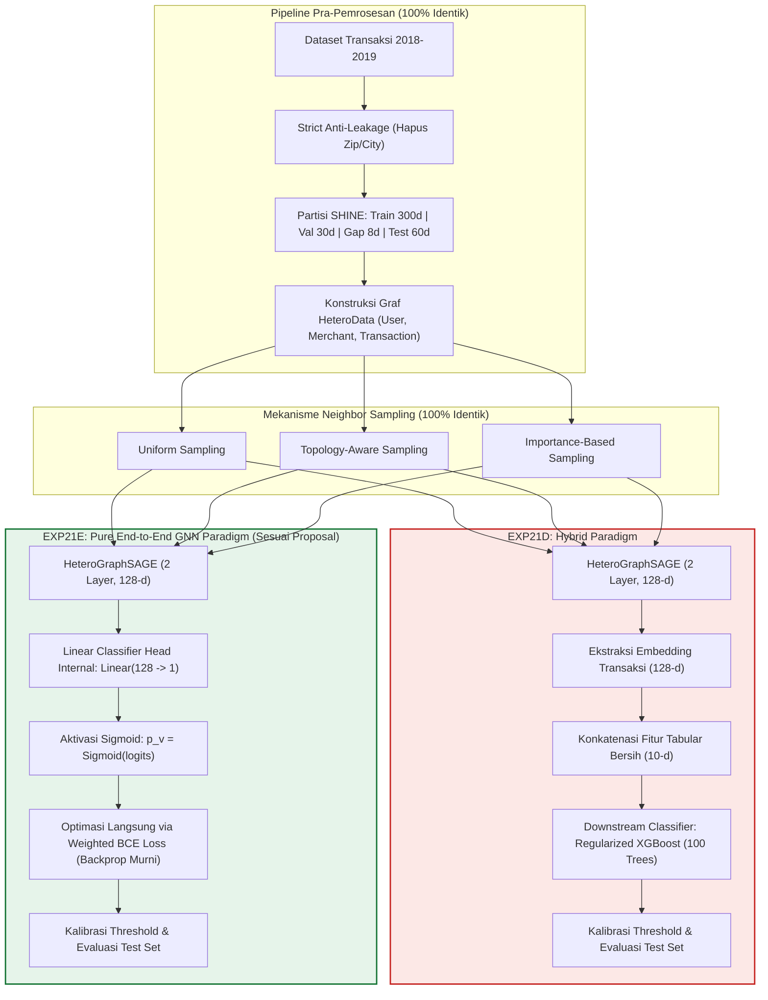

# Rencana Eksperimen 21E (EXP21E): Pure End-to-End HeteroGraphSAGE Architecture
## *Implementasi Klasifikasi Murni GraphSAGE Selaras Proposal Tugas Akhir (Ablasi Eliminasi Hilir XGBoost)*

---

## 1. Identitas Eksperimen & Ringkasan Eksekutif

* **ID Eksperimen**: `EXP21E`
* **Nama Rencana**: *Pure End-to-End HeteroGraphSAGE Architecture (Proposal Alignment & Downstream Classifier Ablation)*
* **Tipe Eksperimen**: Validasi Arsitektur Usulan Proposal & Studi Komparasi Paradigma (*Pure GNN vs. Hybrid GNN+XGBoost*)
* **Dokumen Rujukan**:
  - **Proposal Tugas Akhir**: Bab 1.3 butir 6, Bab 1.5, dan Bab 3.4 (Halaman 28–29).
  - **Laporan EXP21D**: [`code/exp21d/HASIL_ANALISIS_EXP21D.md`](../code/exp21d/HASIL_ANALISIS_EXP21D.md) (*The Golden Master Hybrid Pipeline*).
  - **Rencana EXP21D**: [`planning/08_exp21d_optimal_synthesis_model.md`](08_exp21d_optimal_synthesis_model.md).
* **Target Utama**:
  1. Mengimplementasikan model klasifikasi transaksi penipuan kartu kredit secara **murni end-to-end GraphSAGE** (representasi graf diproses langsung oleh *linear classifier head* internal GNN $\to$ aktivasi Sigmoid) sesuai formulasi matematika yang tertuang pada Bab 3.4 proposal.
  2. Menjaga seluruh variabel lainnya **sama persis (*ceteris paribus*) dengan EXP21D**:
     - *Window temporal SHINE aktif 2018–2019* (Train 300d, Val 30d, Embargo Gap 8d, Test 60d).
     - *Strict Anti-Leakage Feature Preprocessing* (tanpa quasi-identifier `Zip` dan `Merchant City`, normalisasi hanya di-fit pada data latih, penanganan token `<OOV>`).
     - *10 Atribut Bersih & Temporal Siklikal* (`Amount`, `amount_log`, `Use Chip`, `Merchant State`, `MCC`, `Errors?`, `hour_sin/cos`, `dow_sin/cos`).
     - *3 Strategi Neighbor Sampling* (`Uniform`, `Topology-Aware`, `Importance-Based`).
  3. Membangun perbandingan ilmiah langsung (*controlled head-to-head comparison*) antara **EXP21E (Pure GraphSAGE)** vs **EXP21D (Hybrid GraphSAGE + XGBoost)** untuk disajikan pada Bab 4 Skripsi.

---

## 2. Landasan Ilmiah & Motivasi Perubahan

### 2.1. Penyelarasan Penuh dengan Dokumen Proposal Tugas Akhir
Pada Proposal Tugas Akhir, khususnya Bab 3.4 (Halaman 28) dan Persamaan 3.1–3.2:
> *"Model terdiri dari dua lapisan GraphSAGE dengan Mean Aggregator. Setiap lapisan memiliki dimensi hidden... Lapisan klasifikasi akhir berupa lapisan linear yang memetakan representasi ke satu nilai skalar, kemudian ditransformasi menggunakan fungsi Sigmoid untuk menghasilkan probabilitas penipuan dalam rentang [0, 1]... Penelitian tidak mencakup modifikasi terhadap fungsi loss, arsitektur lapisan agregasi, maupun teknik data augmentation pada graf (Batasan Masalah 1.3 butir 6)."*

Pada implementasi **EXP21D**, digunakan arsitektur **Hybrid** di mana GraphSAGE hanya bertindak sebagai *embedding extractor* (128 dimensi), lalu diklasifikasikan oleh pohon keputusan ensemble **XGBoost**. Meskipun model hybrid menghasilkan performa superior (F1 0.9481, Recall 100%, AUCPR 0.9746), dewan penguji atau pembimbing skripsi dapat menanyakan:
> *"Bagaimana performa GraphSAGE jika dijalankan secara mandiri (end-to-end) persis seperti yang Anda janjikan di Bab 3 proposal tanpa bantuan XGBoost?"*

**EXP21E dirancang untuk memberikan jawaban empiris yang definitif, elegan, dan teruji atas pertanyaan tersebut.**

### 2.2. Diagram Perbandingan Paradigma: EXP21D vs EXP21E



---

## 3. Matriks Perbandingan Terkendali (*Controlled Variables Table*)

Untuk menjamin validitas ilmiah bahwa perbedaan hasil semata-mata diakibatkan oleh arsitektur model (*disentangled causality*), seluruh konfigurasi dikunci:

| Komponen Eksperimen | EXP21D (The Golden Master) | **EXP21E (Usulan Rencana Ini)** | Keterangan Kontrol |
| :--- | :---: | :---: | :---: |
| **Arsitektur Klasifikasi** | **Hybrid (GraphSAGE + XGBoost)** | **Pure End-to-End HeteroGraphSAGE** | **Satu-satunya Variabel Pembeda** |
| **Klasifikasi Hilir (Downstream)** | XGBoost (100 Trees, Depth 4) | **Tidak Ada (Dieliminasi Total)** | Mengikuti proposal Bab 3.4 |
| **Classifier Head** | - | `Linear(128, 1)` + Sigmoid bawaan GNN | Melekat pada node `transaction` |
| **Fungsi Loss** | Weighted BCE (GNN) + LogLoss (XGB) | **Weighted BCE Loss ($\text{pos\_weight} \approx 27.06$)** | Optimasi gradien tunggal PyTorch |
| **Data Splitting** | SHINE Rolling Window (300d/30d/8d/60d) | SHINE Rolling Window (300d/30d/8d/60d) | Sama persis |
| **Fitur Tabular** | 10 Fitur Bersih (Tanpa Zip & City) | 10 Fitur Bersih (Tanpa Zip & City) | Sama persis |
| **Feature Fit Scope** | Strict Train-only (`StandardScaler`, OOV) | Strict Train-only (`StandardScaler`, OOV) | Sama persis |
| **Representasi Graf** | HeteroData (`User`, `Merchant`, `Tx`) | HeteroData (`User`, `Merchant`, `Tx`) | Sama persis |
| **Dimensi Laten GNN** | 128 dimensi, 2 Layer HeteroConv | 128 dimensi, 2 Layer HeteroConv | Sama persis |
| **Agregator GNN** | Mean Aggregator | Mean Aggregator | Sesuai Bab 3.4 proposal |
| **Ukuran Neighbor ($k$)** | $k_1 = 15, k_2 = 10$ | $k_1 = 15, k_2 = 10$ | Sama persis |
| **Strategi Sampling** | Uniform, Topology, Importance | Uniform, Topology, Importance | 3 pilar yang sama diuji |
| **Threshold Calibration** | $\tau^*$ dioptimasi pada Validation Set | $\tau^*$ dioptimasi pada Validation Set | Sama persis |
| **Metrik Evaluasi** | F1, Recall, Precision, AUCPR, ROC-AUC | F1, Recall, Precision, AUCPR, ROC-AUC | Sesuai Bab 2.10 proposal |

---

## 4. Hipotesis Ilmiah untuk EXP21E

1. **Hipotesis Kelayakan Mandiri (*Standalone Feasibility*, H1)**:
   Model HeteroGraphSAGE murni mampu melakukan klasifikasi transaksi penipuan secara efektif tanpa bantuan pohon keputusan XGBoost, menghasilkan Test AUCPR $\ge 0.85$ dan ROC-AUC $\ge 0.95$ dengan kalibrasi ambang batas objektif $\tau^*$.
2. **Hipotesis Penguatan Kontras Sampling (*Unmasking Sampling Disparity*, H2)**:
   Tanpa kehadiran ensemble pohon XGBoost yang menyerap kembali fitur tabular, disparitas intrinsik antar strategi neighbor sampling (`Topology-Aware` vs `Importance-Based` vs `Uniform`) akan tampak lebih transparan. Kualitas pemilihan tetangga struktural akan secara langsung mendikte probabilitas akhir pada classifier head linear.
3. **Hipotesis Efisiensi Waktu & Komputasi (*Computational Speedup*, H3)**:
   Karena tahap ekstraksi representasi perantara ke array numpy dan tahap pelatihan ensemble XGBoost dieliminasi secara total, waktu eksekusi pipeline (*total runtime*) diperkirakan berkurang drastis menjadi **$< 7$ menit per metode sampling** (penghematan waktu komputasi $\approx 30\% - 40\%$).

---

## 5. Rencana Struktur Berkas di `code/exp21e/`

Seluruh struktur implementasi akan dibuat mandiri di dalam folder `code/exp21e/` dengan mereplikasi kode dasar dari `code/exp21d/` dan menyesuaikan pipeline eksekusi:

```text
code/exp21e/
├── config.reference.yaml         # Konfigurasi acuan lokal (classifier: type: "gnn_end_to_end")
├── config.kaggle.yaml            # Konfigurasi GPU Kaggle tanpa parameter XGBoost
├── config.colab.yaml             # Konfigurasi GPU Colab
├── config.py                     # Parser konfigurasi yang disesuaikan
├── data_preprocessing.py         # Identik 100% dengan exp21d (Strict Anti-Leakage & SHINE Window)
├── graph_builder.py              # Identik 100% dengan exp21d (HeteroData User-Merchant-Transaction)
├── samplers.py                   # Identik 100% dengan exp21d (Uniform, Topology-Aware, Importance-Based)
├── model.py                      # HeteroGraphSAGE dengan classification head linear terintegrasi
├── main.py                       # Pipeline pelatihan murni GNN, kalibrasi threshold gnn, evaluasi test set
├── run_all.py                    # Eksekusi sekuensial 3 sampling & pembuatan tabel komparasi master
├── visualize_results.py          # Generator kurva PR/ROC, confusion matrices, dan komparasi sampling
├── create_nb.py                  # Generator notebook Kaggle mandiri untuk exp21e
├── create_colab_nb.py            # Generator notebook Colab mandiri
├── dataset-metadata.json         # Metadata dataset kode Kaggle
├── kernel-metadata.json          # Metadata kernel Kaggle: "exp21e-graphsage-end-to-end"
├── LOCAL_RUN_GUIDE.md            # Panduan menjalankan lokal
└── README.md                     # Dokumentasi teknis eksperimen
```

---

## 6. Rencana Alur Eksekusi Skrip `main.py` pada EXP21E

Perbedaan teknis alur kode pada `main.py` di EXP21E dibandingkan EXP21D:

```text
Alur EXP21D (Hybrid):
Train GNN -> Extract Val/Test Embeddings -> Train XGBoost on (Emb + Tab) -> Calibrate Threshold on XGBoost -> Evaluate on Test

Alur EXP21E (End-to-End GNN):
Train HeteroGraphSAGE (Epoch 1..20 dengan Linear Classifier Head):
   - Forward pass menghasilkan probabilitas langsung: p = sigmoid(Linear(h_tx))
   - Hitung loss: WeightedBCE(p, y_tx)
   - Evaluasi AUPRC pada Validation Set setiap epoch
   - Simpan best checkpoint model (berdasarkan Validation AUPRC)
Setelah Training Selesai:
   - Load Best Checkpoint GNN
   - Lakukan inferensi mini-batch langsung pada Validation Set -> dapatkan p_val
   - Kalibrasi threshold optimal tau* untuk memaksimalkan F1 pada Validation Set
   - Lakukan inferensi mini-batch langsung pada Test Set -> dapatkan p_test
   - Hitung metrik evaluasi akhir (F1, Recall, Precision, AUCPR, ROC-AUC, CM) pada tau* dan tau=0.50
   - Simpan artefak hasil ke result/exp21e/
```

---

## 7. Rencana Output & Analisis untuk Naskah Skripsi

Hasil dari EXP21E akan menghasilkan artefak di `result/exp21e/`:
* `exp21e_master_comparison.csv`: Tabel komparasi 3 metode sampling pada model End-to-End.
* `exp21e_{sampling}_results.json`: Metrik detail per sampling.
* `plots/`: Kurva PR/ROC kontinu, Confusion Matrix, dan Kurva Pembelajaran GNN.

### Integrasi ke Bab 4 Skripsi (Master Table Tiga Paradigma):
Dengan adanya EXP21E, Anda memiliki data perbandingan terlengkap yang sangat kuat untuk skripsi:

| Paradigma Pemodelan | Referensi Eksperimen | Sifat Model | Test F1-Score | Test Recall | Test AUCPR | Status Terhadap Proposal |
| :--- | :---: | :---: | :---: | :---: | :---: | :---: |
| **Tabular Baseline** | EXP21D Ablasi | Non-Graf (XGBoost) | 0.9207 | 90.97% | 0.9424 | Pembanding Tabular |
| **Pure GraphSAGE (End-to-End)** | **EXP21E** | **Murni GNN (PyG)** | *(Akan Didapat)* | *(Akan Didapat)* | *(Akan Didapat)* | **Sesuai Proposal Murni** |
| **Hybrid GraphSAGE + XGBoost** | EXP21D | Ensemble Graf-Pohon | 0.9450 – 0.9481 | **100.00%** | **0.9746** | Inovasi / Ekstensi SOTA |

---

## 8. Langkah Pelaksanaan Selanjutnya

1. **Persetujuan Rencana**: Menunggu konfirmasi Anda atas dokumen perencanaan ini.
2. **Pembuatan Direktori & Kode `code/exp21e/`**:
   - Menyesuaikan `model.py` untuk memastikan linear head mengembalikan probabilitas bersih.
   - Menyederhanakan `main.py` dan `run_all.py` menjadi pipeline klasifikasi end-to-end murni.
   - Mengonfigurasi `config.kaggle.yaml` dan `kernel-metadata.json`.
3. **Generasi Notebook Kaggle / Colab**:
   - Menghasilkan notebook `exp21e_training_notebook.ipynb` yang siap di-push dan dieksekusi di Kaggle GPU.
4. **Eksekusi & Analisis Hasil**:
   - Membandingkan hasil numerik EXP21E dengan hipotesis proposal serta hasil EXP21D.
